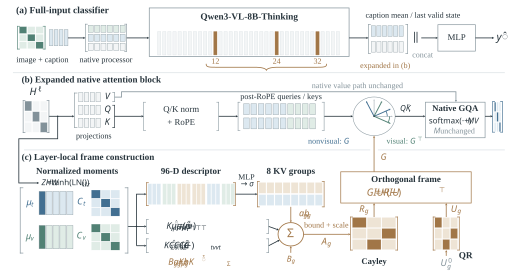

# CMCR: Cross-Modal Commutator Rotation

**Cross-Modal Commutator Rotation for Multimodal Sarcasm Detection: Relative Attention Geometry and Controlled Evaluation**

Qiuyu Li, Yushan Pan, Chen Xing, Di Wu, Ho-Pun Lam, Yushi Li, Yanlong Cao, and Zhijie Xu

## Overview

Multimodal sarcasm detection requires understanding how visual context qualifies textual meaning, rather than simply maximizing image–text alignment. We propose Cross-Modal Commutator Rotation (CMCR), a geometrically constrained mechanism for adapting cross-modal attention. CMCR constructs sample-conditioned low-rank rotations from first- and second-order modality statistics and applies distinct coordinate frames to visual and non-visual queries and keys. For fixed layer inputs, this design preserves same-frame query–key inner products in exact arithmetic while allowing cross-frame attention scores to change. Experiments on MMSD2.0 show that CMCR with Qwen3-VL-8B-Thinking achieves 87.21% accuracy and 87.12% macro-F1. Cross-scale comparisons, ablation studies, and diagnostic analyses characterize the effects of its components and the resulting predictive behavior. CMCR provides a geometrically explicit approach to studying and adapting modality-relative interactions for multimodal sarcasm detection. The source code is publicly available at https://github.com/CICC-XJTLU/CMCR.

<p align="center">
  
</p>

The implementation includes CMCR, a static-rotation control (Static), and a first-order control without the commutator (NoComm).

## Paper

The current manuscript is available as a [PDF](paper/main.pdf).

## Setup

Use Python 3.10 and a CUDA-enabled GPU.

```bash
git clone https://github.com/CICC-XJTLU/CMCR.git
cd CMCR

pip install torch==2.6.0 torchvision==0.21.0 --index-url https://download.pytorch.org/whl/cu118
pip install -r requirements.txt

hf download Qwen/Qwen3-VL-8B-Thinking \
  --revision 92f3c4b4feadd3a016ef468d103bb5f58b2a2c6b \
  --local-dir models/Qwen3-VL-8B-Thinking
```

## Data

Download the text and images from [MMSD2.0](https://github.com/JoeYing1019/MMSD2.0). The experiments use cleaned splits with 19,344 training, 2,393 validation, and 2,409 test examples. Store the corresponding JSONL files as:

```text
data/clean/
├── train.jsonl
├── val.jsonl
└── test.jsonl
```

Each record contains `id`, `text`, `image`, and `label`. The `image` field points to a local image file. Labels are `sarcastic` / `not_sarcastic`, or equivalently `1` / `0`. Keep the three splits separate. Model and data paths are configured in the JSON files under `configs/`.

## Training and Evaluation

Run commands from the repository root:

```bash
CUDA_VISIBLE_DEVICES=0 python -m scripts.train \
  --config configs/qwen3vl8b/cmcr.json

CUDA_VISIBLE_DEVICES=0 python -m scripts.evaluate \
  --checkpoint outputs/qwen3vl8b/cmcr/checkpoint-best \
  --data data/clean/test.jsonl
```

Replace `cmcr.json` with `static.json` or `no_comm.json` to run the component controls. Configurations for the 4B backbone are in `configs/qwen3vl4b/`; download the corresponding Qwen3-VL-4B-Thinking model before using them.

Training runs for two epochs with seed 42, selecting the checkpoint by validation macro-F1. Checkpoints contain the LoRA adapter and CMCR/classification-head weights. Evaluation writes class probabilities, predictions, and classification metrics. The training entry point also evaluates the selected checkpoint on the test set.

## Results

MMSD2.0 results with Qwen3-VL-8B-Thinking, using the same data and training budget:

| Method | Accuracy (%) | Macro-F1 (%) |
|:--|--:|--:|
| Static | 87.05 | 86.95 |
| NoComm | 86.92 | 86.81 |
| CMCR | 87.21 | 87.12 |

## Repository Structure

```text
cmcr/          Model, attention rotation, and data loading
configs/       Backbone and method configurations
scripts/       Training and checkpoint evaluation
tests/         Configuration, training-path, and operator tests
assets/        Paper architecture figure
paper/         Current manuscript PDF
```

```bash
python -m unittest discover -s tests -v
```

## Citation

```bibtex
@misc{li2026cmcr,
  title  = {Cross-Modal Commutator Rotation for Multimodal Sarcasm Detection:
            Relative Attention Geometry and Controlled Evaluation},
  author = {Li, Qiuyu and Pan, Yushan and Xing, Chen and Wu, Di and Lam, Ho-Pun
            and Li, Yushi and Cao, Yanlong and Xu, Zhijie},
  year   = {2026}
}
```

## Acknowledgments

Built with [Qwen3-VL](https://huggingface.co/Qwen/Qwen3-VL-8B-Thinking), [Transformers](https://github.com/huggingface/transformers), and [PEFT](https://github.com/huggingface/peft). We thank the [MMSD2.0](https://github.com/JoeYing1019/MMSD2.0) authors for the benchmark.

## License

Code is released under the [MIT License](LICENSE).
